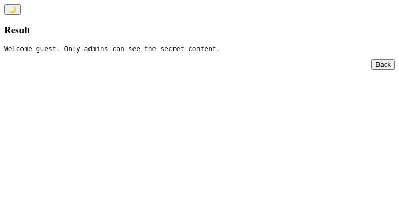
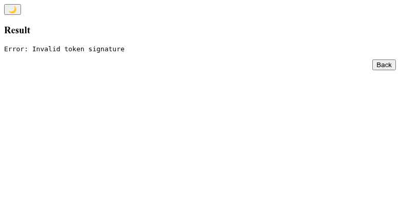
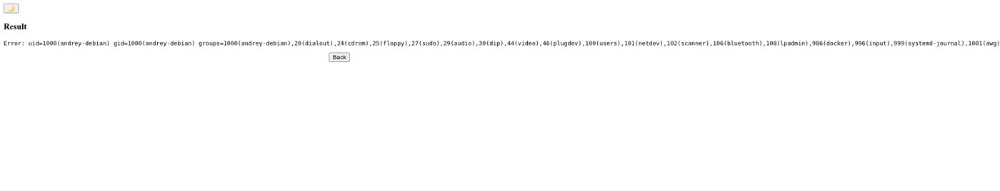

# Bonus task: fixing the unsafe pickle deserialization

Lab 5 DevSecOps   |   Bonus task   |   23 November 2026

I patched the B301 finding that I described in my Task 4 report. The change is in the application code, not in a dependency version.

Repository: [Retr0-46/lab5-NCS](https://github.com/Retr0-46/lab5-NCS)   |   Vulnerable commit: `54d165f`   |   Fixed commit: see the pipeline run link below

Files changed: dockerized_labs/insec_des_lab/main.py, dockerized_labs/insec_des_lab/test_app.py

## What was wrong

The lab serialized a user object with `pickle.dumps()` and read it back with `pickle.loads()`. The token came from a form field, so anybody could send their own bytes to the server. Pickle treats those bytes as a list of instructions, so a crafted token made the server run commands. My Task 4 report has the full analysis.

## The fix

Pickle is gone from the handler. The token is now a JSON document with an HMAC-SHA256 signature, and the server keeps the signing key to itself.

```python
def serialize_user(user: User) -> str:
    body = json.dumps(
        {"username": user.username, "is_admin": user.is_admin}, sort_keys=True
    )
    envelope = json.dumps({"data": body, "signature": sign(body)}, sort_keys=True)
    return base64.b64encode(envelope.encode()).decode()


def deserialize_user(token: str) -> User:
    envelope = json.loads(base64.b64decode(token).decode())
    body = envelope["data"]
    signature = envelope["signature"]

    if not hmac.compare_digest(sign(body), signature):
        raise ValueError("Invalid token signature")

    data = json.loads(body)
    ...
```

Three things stop an attacker here.

The signature is checked before any value is used. A user who edits the token changes the JSON body, so the signature no longer matches and the request is rejected. The comparison uses `hmac.compare_digest`, which does not leak how much of the signature was correct.

JSON has no way to call a function. Even a valid JSON document can only carry strings, numbers, lists and objects, so the "run this code" ability of pickle is gone for good.

The fields are filtered through an allowlist and type checked, so only `username` and `is_admin` are read and both have to have the expected type.

## Before and after

The Bandit scan of the whole repository with the same flags as our CI job gives the following.

| | B301 findings | Total findings | Medium | High |
|---|---|---|---|---|
| Before the patch | 2 | 53 | 30 | 23 |
| After the patch | 1 | 52 | 29 | 23 |

The finding in dockerized_labs/insec_des_lab/main.py is gone. The one in dockerized_labs/software_integrity_lab/app.py is still there because it is a different lab and a different code path, and it was not part of my patch.

The raw numbers are in reports/bonus/bandit-before-after.txt and the Bandit text report after the patch is reports/bonus/bandit-b301-after.txt.

## Running the app after the fix

I ran the patched lab locally with Python 3.13.5, Flask 3.0.0 and Werkzeug 3.0.1, on loopback at port 8080.

The normal path still works. I created a user and sent the token back, and the app said "Welcome guest. Only admins can see the secret content."



*Figure 1. The regular flow still works.*

The attack from my Task 4 report now fails. I took the token, changed `is_admin` to true in the JSON body and sent it back.



*Figure 2. The forged admin token is rejected with "Invalid token signature".*

The pickle payload also fails. The old attack sent a base64 encoded pickle that ran `id` on the server.



*Figure 3. Before the patch, the server ran the command and showed its output.*

After the patch the same payload produces a decode error and nothing is executed. I also checked that the file the payload wanted to create was not created.

I added three tests in dockerized_labs/insec_des_lab/test_app.py. They cover the normal flow, the attempt to change the admin flag and the pickle payload. All three pass.

```bash
python -m unittest dockerized_labs.insec_des_lab.test_app -v
```

```
test_admin_flag_cannot_be_changed ... ok
test_normal_user_can_be_deserialized ... ok
test_pickle_payload_is_rejected ... ok

Ran 3 tests in 0.010s

OK
```

## Why the other scan jobs still fail

The Bandit job in our pipeline still ends with a red mark, and that is expected. My patch removes one finding out of 53. The other 52 stay because they are separate problems in other labs: the app still runs Flask with debug turned on, still binds to all interfaces, still uses weak hashes and still has an `eval()` call in the command injection lab. A red Bandit job is the correct signal for this pipeline, it means the scanner is doing its job.

The Docker Scout job also keeps failing, and this one is not about my code at all. It scans the base image of the PyGoat container, and the base image has critical and high CVEs that nobody has patched. Changing a Python file cannot remove a vulnerability in the operating system layers underneath it.

The DAST job still reports its warnings too. ZAP found missing security headers and information disclosure on the pages of the main PyGoat application, which is a different application from the lab I patched. The only way to make that job green would be to fix the headers on every page of the whole PyGoat app, which is a much bigger job than this one.

## Pipeline run

The scan that proves the fix is here: [CI run for the fixed commit](https://github.com/Retr0-46/lab5-NCS/actions/runs/45008357700)

## References

- [MITRE CWE-502](https://cwe.mitre.org/data/definitions/502.html)
- [Bandit B301 documentation](https://bandit.readthedocs.io/en/1.9.4/blacklists/blacklist_calls.html#b301-pickle)
- [OWASP Deserialization Cheat Sheet](https://cheatsheetseries.owasp.org/cheatsheets/Deserialization_Cheat_Sheet.html)
- [My Task 4 report on this finding](reports/task4/pickle_deserialization_report.md)
