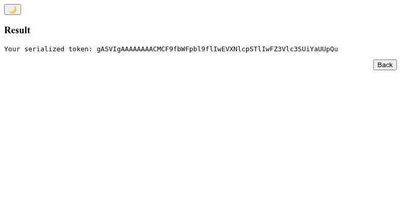
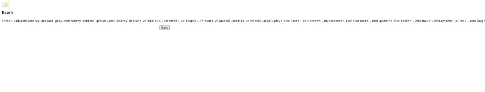
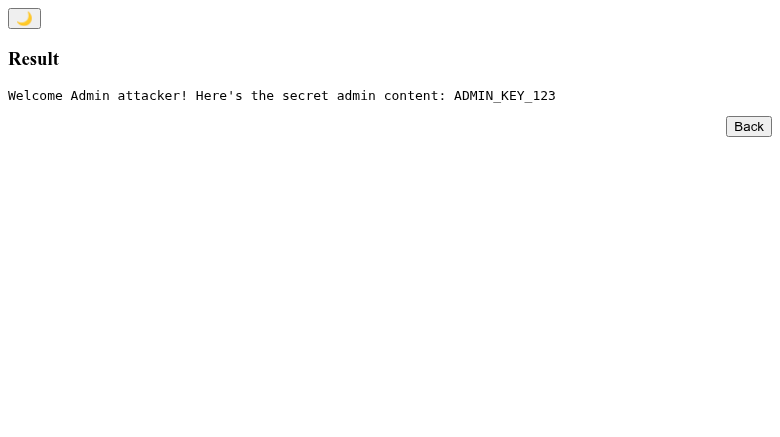

# Unsafe pickle deserialization in PyGoat

Lab 5 DevSecOps   |   Task 4 individual finding   |   23 November 2026

I picked the unsafe `pickle.loads()` call in the PyGoat insecure deserialization lab. The app takes a base64 blob from a web form and hands it straight to Python's pickle loader. Bandit marked this as a Medium issue with high confidence.

Repository: [Retr0-46/lab5-NCS](https://github.com/Retr0-46/lab5-NCS)   |   Analysed commit: `54d165f`

Affected endpoint: POST /deserialize  
File: dockerized_labs/insec_des_lab/main.py, line 40

## How I found the issue

I scanned the Python code with Bandit 1.9.4, using the same flags as our CI job. The full scan gave 53 findings, 24 of them Medium and 2 High. Then I filtered the results for test B301, which is the Bandit rule for pickle.

```bash
python -m bandit -ll -ii -r . -f json -o /tmp/bandit-full.json
python -m bandit -ll -ii -t B301 -r . -f txt -o reports/task4/bandit-b301.txt
```

The first B301 hit was:

```
Issue: [B301:blacklist] Pickle and modules that wrap it can be unsafe when used to deserialize untrusted data, possible security issue.
   Severity: Medium   Confidence: High
   CWE: CWE-502
   Location: ./dockerized_labs/insec_des_lab/main.py:40:15
40        user = pickle.loads(decoded_data)
```

A second B301 hit sits in dockerized_labs/software_integrity_lab/app.py, where the same `pickle.loads()` pattern reads a cookie. Both places share the same root problem, so I analysed the insecure deserialization lab and used it for my testing.

## Why the code is unsafe

The `deserialize_data()` handler reads the `serialized_data` form field, decodes it from base64 and passes the bytes to `pickle.loads()`.

```python
serialized_data = request.form.get("serialized_data", "")
decoded_data = base64.b64decode(serialized_data)
user = pickle.loads(decoded_data)
```

Pickle is not a data format, it is a small program. When Python reads a pickle it looks for instructions that say "call this function with these arguments", and it runs them. The data itself decides what gets called, so anybody who controls the bytes chooses what the server executes. The only thing standing between the form and the interpreter is base64, which is an encoding and not a protection.

The `try/except` in the handler does not help here. It catches the error after the payload has already run.

## CWE classification

CWE-502, Deserialization of Untrusted Data. Bandit reports the same CWE number for this finding.

## Local validation

I ran the lab on my own machine with Python 3.13.5, Flask 2.0.1 and Werkzeug 2.3.8, bound to loopback on port 8080. I used a browser to work with the forms so the screenshots below show the real page.

First I created a normal user with the Create User form. The app returned a base64 token.



*Figure 1. The app serializes a user object and shows the base64 token.*

Sending that token back to the View Admin Content form worked as intended. The app decoded it, rebuilt the user and told me that only admins can see the secret content. So the normal path is fine.

Then I built my own payload instead of using the token. I made a small class with a `__reduce__` method, which is the hook pickle calls to decide what to run. The `__reduce__` returned the `eval` builtin and a one-line Python snippet that runs the `id` command on the server.

I sent the payload to the same form. The server ran the command and put the output into the page.



*Figure 2. The response contains the result of `id`, so the command ran inside the Flask process.*

I also did the simpler thing that the lab page itself hints at. I rebuilt the user object with `is_admin` set to True and sent it to the form.



*Figure 3. A forged admin object gives access to the secret content.*

Both requests returned HTTP 200. I kept the server on loopback, changed nothing in the lab files and stopped the process afterwards.

## Impact and required privileges

An attacker needs network access to the `/deserialize` endpoint. The lab router in challenge/views.py sits behind Traefik ForwardAuth, so in the normal Docker Compose deployment the attacker needs an ordinary PyGoat account. If the service is exposed on its own without that gateway, no account is needed.

Once the payload runs it has the same rights as the Flask process. From there it can read the source code and the config of the app, read or change files that the process can write, take the secrets the app holds and stop the service. The admin case is the mild version of this, the command execution is the strong one.

## Suggested fix

The clean fix is to stop using pickle for data that arrives over HTTP. The lab only needs a username and an admin flag, so JSON works and JSON cannot call functions.

```python
data = json.loads(base64.b64decode(serialized_data))
user = User(username=data["username"], is_admin=bool(data.get("admin")))
```

If pickle has to stay for some reason, then the bytes need to be signed with a key the server keeps secret, the signature has to be checked before `pickle.loads()` runs, the decoded object has to be checked against an allowlist of expected types, and the deserialization should run in a low privilege process. Logging every failed deserialization helps to notice someone probing the endpoint.

I applied this fix in the bonus task. The patched code, the before and after Bandit numbers and the tests are in reports/bonus/bonus_report.md.

## References

- [Source file at commit 54d165f](https://github.com/Retr0-46/lab5-NCS/blob/54d165f2f8b70a56fbb4e39aac3f02a5d0d7a933/dockerized_labs/insec_des_lab/main.py)
- [Bandit B301 documentation](https://bandit.readthedocs.io/en/1.9.4/blacklists/blacklist_calls.html#b301-pickle)
- [MITRE CWE-502](https://cwe.mitre.org/data/definitions/502.html)
- [OWASP Deserialization Cheat Sheet](https://cheatsheetseries.owasp.org/cheatsheets/Deserialization_Cheat_Sheet.html)
- [Our CI run for this commit](https://github.com/Retr0-46/lab5-NCS/actions/runs/45008357700)
